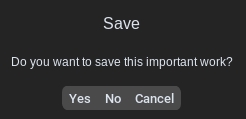
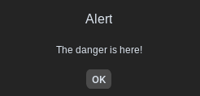
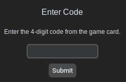

# ctkdialog
_ctkdialog_ is a simple dialog module for Python, using CustomTkinter.

## Dependencies
|Dependencies|Website|
| ----------- | --- |
|python3 >= 3.7|[https://www.python.org](https://www.python.org)|
|python3-tk|[https://www.python.org](https://www.python.org)|
|CustomTkinter|[https://customtkinter.tomschimansky.com/](https://customtkinter.tomschimansky.com/)|

_For CustomTkinter, you may need to set up a venv, use python3-venv for that_

## How to implement
Currently, this module has 4 main functions, which do the following:
|Function|Usecase|
|---|---|
|`yesno(text,content)`|Shows a yes/no dialog, with _text_ being the title and _content_ being the content|
|`yesnocancel(text,content)`|Shows a yes/no/cancel dialog, does the same as `yesno(text,content,add_cancel=True)`|
|`okay(text,content)`|Shows an information dialog, with _text_ being the title and _content_ being the content|
|`textinput(text,content)`|Asks for a single line text entry, with _text_ being the title and _content_ being the content|

For detailed information on these functions, refer to [DOCUMENTATION.md](DOCUMENTATION.md) or look at the [example python script](demo.py).

## Screenshots
### Yes/No Dialog

### Yes/No/Cancel Dialog

### Okay Dialog

### Text Input Dialog

## Extra Notes
**This is currently Linux-only! It may not work on other platforms.**
